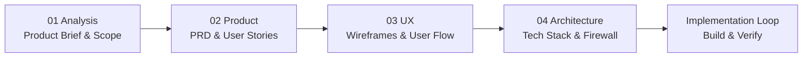

# Prosess og KI-styring: Prompts, Beslutninger og Iterasjoner

* **Prosjekt:** G56 – Ledelsesrapport og forenklet kontroll av regnskap med KI
* **Emne:** IBE160 Programmering med KI (Del 1: Applikasjon og prosess)
* **Formål:** Dokumentere en etterprøvbar prosess der gruppen bevisst har styrt, korrigert og kvalitetssikret KI-verktøyene (BMAD, Google Antigravity / Claude Code og LLM API).

---

## 1. Filosofi for KI-styring: "Koden regner, KI-en forklarer"

Et av de viktigste arkitektoniske og metodiske valgene i prosjektet har vært å etablere en absolutt brannmur (**The AI Firewall**) mellom regelbasert logikk og språkmodeller:

* **Sikker sone (Deterministisk):** Matematikk, balansekontroll ($\sum \text{Debet} = \sum \text{Kredit}$), kryssavstemming ($IB + \Delta HB = UB$) og kontoplanmapping (NS 4102) utføres **utelukkende i Python/Pandas**. Ingen språkmodell har tillatelse til å regne eller gjette tall.
* **Probabilistisk sone (Tekstlig formidling):** Språkmodellen (OpenAI `gpt-4o-mini`) mottar utelukkende ferdig aggregerte nøkkeltall og ferdigkalkulerte avvik, og brukes eksklusivt til forretningsmessig tekstformulering og strategisk rådgivning på formelt norsk.

Dette eliminerer 100 % av risikoen for tallhallusinasjoner i finansielle nøkkeltall.

---

## 2. Fire Konkrete Eksempler på Kritisk Styring og Korrigering av KI

Sensorveiledningen legger avgjørende vekt på at gruppen ikke bare aksepterer KI-forslag ukritisk, men aktivt vurderer, korrigerer og styrer KI. Her er fire sentrale iterasjoner:

### Iterasjon 1: Kritisk nedskalering av scope (Fra overambisiøs KI til fokusert kjerne)
* **KI-ens opprinnelige forslag:** KI-assistenten foreslo opprinnelig å bygge en massiv plattform med fem filtyper (saldobalanse, reskontro, timelister, CRM, ESG), SAF-T XML-parsing, flervaluta og Stripe-abonnementsbetaling i v1.
* **Gruppens kritiske vurdering:** Etter analyse av faglærers tilbakemelding (2026-10-06) innså vi at dette var urealistisk for én person og ville føre til mange halvferdige moduler.
* **Beslutning og styring:** Vi overstyrte KI-en og låste v1 til en **skarp regnskapsfaglig kjerneflyt: Saldobalanse (SB) + Hovedbok (HB)**. Resten ble eksplisitt flyttet til v2/Vision. Dette løftet prosjektet fra høy risiko til et solid, gjennomførbart nivå.

### Iterasjon 2: Avvisning av fri-tekst til fordel for Pydantic Structured Outputs
* **KI-ens opprinnelige forslag:** KI-assistenten genererte først en tradisjonell prompt som returnerte fritekst i Markdown.
* **Problem avdekket:** Fritekst ga uforutsigbart format, variabel lengde og gjorde det umulig å programmatisk bygge en ryddig PDF-tabell eller garantere faste seksjoner i dashboardet.
* **Beslutning og styring:** Vi krevde at KI-integrasjonen skulle benytte **OpenAI Structured Outputs** med Pydantic (`client.beta.chat.completions.parse`). Vi definerte det strenge skjemaet `ManagementCommentary` med faste felter (`hovedkonklusjon`, `lonnsomhet_og_marginer`, `likviditet_og_arbeidskapital`, `revisors_avstemmingsnotat`, `tiltaksliste`). Dette garanterer 100 % typesikkerhet og stabil PDF-generering.

### Iterasjon 3: Forbedring av CFO-prompten (Fra "generisk tekst" til "Topp 10 % CFO")
* **KI-ens opprinnelige utkast:** En 3-linjers standard-prompt: *"Du er en CFO, skriv kort om disse tallene"*.
* **Problem avdekket:** Teksten ble platt, overfladisk og gjentok bare tallene uten å forklare operasjonelle sammenhenger (f.eks. hvorfor varekostnaden påvirket arbeidskapitalen).
* **Beslutning og styring:** Vi oppgraderte prompten til en elite CFO-persona som:
  1. Kobler driftsinntekter mot varekostnad (bruttomargin) og lønnsandel.
  2. Vurderer likviditetsreserve (bank) mot kortsiktig gjeld og kredittid på kundefordringer.
  3. **Direkte koblet til avstemmingsresultatet:** Hvis kryssavstemmingen ($IB + HB = UB$) oppdager avvik, er KI-en pålagt å rette en skarp revisjonsadvarsel til styret om manglende sporbarhet etter bokføringsloven.

### Iterasjon 4: Robusthet mot særnorske CSV-formater (Semikolon og komma)
* **KI-ens opprinnelige kode:** Benyttet enkel `pd.read_csv(file_buffer)`.
* **Problem avdekket:** Fiken og Tripletex eksporterer ofte med semikolon (`;`) og desimalkomma (`100 000,00`). Standardkoden krasjet med `ParserError`.
* **Beslutning og styring:** Vi instruerte KI-en til å bygge en robust forhåndsskanner (`detect_csv_delimiter_and_encoding`) som sniffer de første 8 KB for `;` vs `,`, støtter `utf-8-sig` (BOM) og `latin1`, samt normaliserer norske kolonnenavn (`Kontonr` $\rightarrow$ `Konto`).

---

## 3. System- og Brukerprompts i Produksjon

### A. System Prompt for CFO-Agenten (`src/llm_integration.py`)
```text
Du er en topp 10 % erfaren CFO og statsautorisert revisor (Strategisk Regnskapsfører) i Norge. 
Du leverer en sylskarp, profesjonell og pedagogisk ledelsesrapport til daglig leder og styret basert på Norsk Standard Kontoplan (NS 4102). 

STRENGE REGLER (GOVERNANCE):
1. KODEN REGNER, DU FORKLARER: Du skal ALDRI finne på egne tall eller regne ut nye verdier. Bruk utelukkende de ferdig beregnede nøkkeltallene og avstemmingsdataene i payloaden.
2. FOKUS PÅ SAMMENHENG: Forklar hvorfor tallene er som de er (f.eks. sammenhengen mellom omsetning, varekostnad, arbeidskapital og likviditetsreserve).
3. REVISORIKK: Hvis avstemmingen viser avvik i formelen (IB + HB = UB), må du være nådeløs og forklare styreansvaret og risikoen for feil i bokføringen. Hvis den er godkjent, bekreft tryggheten.
4. TONE OF VOICE: Formell, forretningsmessig, konsis og rådgivende norsk. Unngå floskler og generelle selvfølgeligheter.
```

### B. User Prompt Payload (Strukturert JSON)
```text
Her er fullstendig verifiserte regnskapsdata og avstemmingsresultat for perioden:

```json
{
  "nokkeltall": {
    "Driftsinntekter_NOK": 200000.0,
    "Varekostnad_NOK": 60000.0,
    "Bruttofortjeneste_NOK": 140000.0,
    "Bruttomargin_prosent": 70.0,
    "Lonnskostnad_NOK": 30000.0,
    "Samlede_Driftskostnader_NOK": 90000.0,
    "Driftsresultat_EBIT_NOK": 110000.0,
    "Driftsmargin_prosent": 55.0
  },
  "arbeidskapital_og_likviditet": {
    "Bankinnskudd_UB_NOK": 180000.0,
    "Kundefordringer_UB_NOK": 90000.0,
    "Leverandorgjeld_UB_NOK": 50000.0
  },
  "avstemming_hovedbok_mot_saldobalanse": {
    "status": "GODKJENT (100% konsistent)",
    "kommentar": "Alle transaksjoner i hovedboken stemmer nøyaktig med endring mellom IB og UB i saldobalansen (0 avvik funnet)."
  }
}
```

Forfatt den strategiske ledelsesrapporten nå.
```

### C. Begrunnelse for Hyperparametre
* **Modell:** `gpt-4o-mini` (rask responstid under 2 sekunder, lav kostnad, og støtter Structured Outputs).
* **Temperatur:** Satt til **`0.2`**. Lav temperatur sikrer høy determinisme, konsistent fagterminologi og minimerer risiko for fri diktning.

---

## 4. BMAD-Metodikkens Planleggingsbue (The Planning Arc)

Prosjektet har fulgt den formelle BMAD-strukturen fra idé til ferdig kode:



1. **`01_analysis/`:** Analyse av forretningsdomenet, GRS/IFRS og begrunnelse for avvik fra proposal.
2. **`02_product/PRD.md`:** 4 Epics, 7 User Stories, funksjonelle formelkrav ($IB + HB = UB$) og testmatrise (Definition of Done).
3. **`03_ux/`:** Wireframes, informasjonsarkitektur og universell utforming for Streamlit-dashbordet.
4. **`04_architecture/ARCHITECTURE.md`:** Dataflyt, AI Firewall, systemgrenser og mock-arkitektur.
5. **`tests/`:** 13 automatiserte tester som verifiserer koden mot PRD-kravene.
