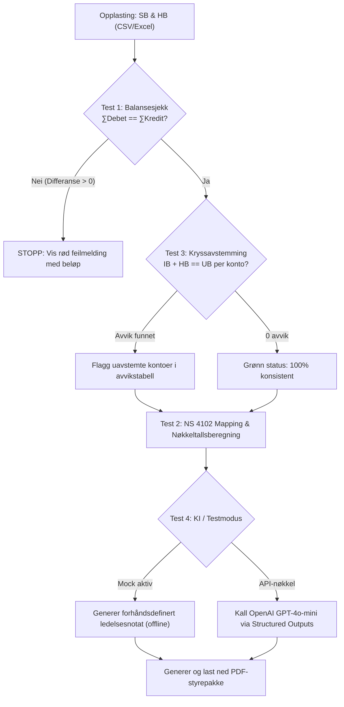

# Product Requirements Document (PRD)
## Ledelsesrapport og forenklet kontroll av regnskap med KI (v1)

* **Dokument-ID:** PRD-01
* **Prosjekt:** G56 – Ledelsesrapport og forenklet kontroll av regnskap med KI
* **Forankring:** Bygger direkte på `product-brief.md` (revidert v1) og tilbakemelding fra faglærer.
* **Målgruppe:** Sensor, utviklere og interessenter i IBE160.

---

## 1. Innledning og Formål

Dette dokumentet definerer de bindende funksjonelle og ikke-funksjonelle kravene for versjon 1 (v1) av applikasjonen. PRD-en fungerer som det formelle bindeleddet mellom forretningsbehovene i `product-brief.md` og den tekniske kildekoden. Hver modul, funksjon og test i prosjektet skal kunne spores direkte tilbake til kravene spesifisert i dette dokumentet.

Kjerneprinsippet for applikasjonen er:
> **Koden regner, KI-en forklarer.**

All matematikk, internkontroll og avstemming skjer deterministisk i ren Python/Pandas. Språkmodellen (LLM) mottar utelukkende ferdig aggregerte tall og forhåndskalkulerte avvik, og brukes eksklusivt til forretningsmessig tekstformulering på norsk.

---

## 2. Epics og Brukerhistorier (User Stories)

Utviklingen av v1 er strukturert i fire hoved-epics med tilhørende brukerhistorier i formatet:
*Som [bruker], ønsker jeg [handling], slik at [verdi].*

### Epic 1: Dataopptak og Validering
*Mål: Sikre et robust og trygt inntak av regnskapsdata fra to kilder, samt umiddelbar matematisk validering.*

* **Story 1.1: Sikker filopplasting**
  * *Brukerhistorie:* Som daglig leder, ønsker jeg å laste opp både Saldobalanse (SB) og Hovedbok (HB) som CSV- eller Excel-filer via et oversiktlig Streamlit-grensesnitt, slik at jeg enkelt kan levere regnskapsdataene mine uten manuell konvertering.
  * *Kravkobling:* FR-1.1, FR-1.2
* **Story 1.2: Dobbelt bokføringskontroll**
  * *Brukerhistorie:* Som regnskapsfører/daglig leder, ønsker jeg umiddelbar tilbakemelding dersom en av filene ikke balanserer ($\sum \text{Debet} \neq \sum \text{Kredit}$), slik at jeg unngår å analysere eller rapportere på et matematisk korrupt regnskap.
  * *Kravkobling:* FR-1.3, NFR-2.1

### Epic 2: Avstemming og Mapping
*Mål: Verifisere logisk konsistens mellom transaksjoner og saldo, samt standardisere kontostrukturen.*

* **Story 2.1: Kryssavstemming (HB mot SB)**
  * *Brukerhistorie:* Som daglig leder, ønsker jeg at systemet automatisk kontrollerer at $\text{Inngående Balanse (IB)} + \sum(\text{Transaksjoner i HB}) = \text{Utgående Balanse (UB)}$ for samtlige kontoer, slik at eventuelle feilkonteringer eller uavstemte poster i perioden avdekkes før styremøtet.
  * *Kravkobling:* FR-2.1, FR-2.2
* **Story 2.2: Mapping til Norsk Standard Kontoplan (NS 4102)**
  * *Brukerhistorie:* Som daglig leder, ønsker jeg at kontoene mine automatisk klassifiseres etter NS 4102 (Eiendeler, Gjeld, Salgsinntekter, Driftskostnader, Finansposter), slik at regnskapet aggregeres til standardiserte ledelsesstørrelser uten manuell oppmerking.
  * *Kravkobling:* FR-2.3

### Epic 3: KI-rapportering og Mock-modus
*Mål: Transformere kontrollerte tall til et forklarende forretningsnotat, samt sikre 100 % lokal sensorvennlighet.*

* **Story 3.1: Strukturert KI-ledelsessammendrag**
  * *Brukerhistorie:* Som daglig leder, ønsker jeg et velskrevet, formelt ledelsesnotat på norsk (CFO-tone) med identifiserte faresignaler og en prioritert tiltaksliste, slik at jeg kan forklare tallenes betydning for styret på sekunder.
  * *Kravkobling:* FR-3.1, FR-3.2
* **Story 3.2: Frakoblet sensormodus (Mock AI)**
  * *Brukerhistorie:* Som sensor eller ekstern evaluator, ønsker jeg å kunne kjøre applikasjonen lokalt uten egen OpenAI API-nøkkel via en enkel "Testmodus"-bryter, slik at jeg kan vurdere hele arbeidsflyten og rapportgenereringen uten kostnader eller eksterne avhengigheter.
  * *Kravkobling:* FR-3.3, NFR-1.2

### Epic 4: Eksport og Visning
*Mål: Presentere innsikten pedagogisk på skjerm og levere en presentasjonsklar styrepakke.*

* **Story 4.1: Nedlasting av PDF-styrepakke**
  * *Brukerhistorie:* Som daglig leder, ønsker jeg å laste ned en ferdig formatert PDF-rapport med tittel, nøkkeltall, avstemmingsstatus og KI-tekst med ett klikk, slik at jeg kan legge en profesjonell styrepakke rett på møtebordet.
  * *Kravkobling:* FR-4.1, FR-4.2

---

## 3. Kravspesifikasjon

### A. Funksjonelle Krav (Functional Requirements - FR)

| ID | Tittel | Beskrivelse | Akseptkriterium |
|:---|:---|:---|:---|
| **FR-1.1** | Filformater | Systemet skal akseptere filer av typene `.csv` og `.xlsx` (Excel). Filene leses in-memory via `io.BytesIO`. | CSV og Excel lastes inn uten å skrives til fysisk disk. |
| **FR-1.2** | Kolonnekrav | Saldobalanse krever kolonnene `Konto`, `IB`, `Debet`, `Kredit`, `UB` (eller beregnbar struktur). Hovedbok krever `Konto`, `Debet`, `Kredit`. | Manglende obligatoriske kolonner gir en forklarende feilmelding i UI. |
| **FR-1.3** | Balansekontroll | Systemet skal verifisere at $\sum \text{Debet} = \sum \text{Kredit}$ for både SB og HB med flyttallstoleranse $\le 0.01$ NOK. | Dersom differansen $> 0.01$, stoppes videre prosessering og avviksbeløpet vises med rød varsling. |
| **FR-2.1** | Kryssavstemming | Systemet skal beregne netto bevegelse per konto i HB: $\Delta \text{HB} = \sum \text{Debet} - \sum \text{Kredit}$. Deretter kontrolleres formelen: $\text{Beregnet UB} = \text{IB} + \Delta \text{HB}$. | Differanse $= \text{UB} - \text{Beregnet UB}$. Hvis differanse $\neq 0$, flagges kontoen som uavstemt. |
| **FR-2.2** | Avviksrapportering | Ved funn av uavstemte kontoer skal systemet vise en tabell med: `Konto`, `Kontonavn`, `IB`, `Netto_HB`, `Beregnet_UB`, `UB` og `Avvik`. | Brukeren ser nøyaktig hvilke kontoer som ikke stemmer og feilbeløpet. |
| **FR-2.3** | NS 4102 Mapping | Norske 4-sifrede kontonumre skal mappes til kontoklasser: `1xxx` $\rightarrow$ Eiendeler, `2xxx` $\rightarrow$ Egenkapital og gjeld, `3xxx` $\rightarrow$ Salgsinntekter, `4xxx–7xxx` $\rightarrow$ Driftskostnader, `8xxx` $\rightarrow$ Finans og skatt. | Alle gyldige kontonumre tildeles korrekt kontogruppe. |
| **FR-2.4** | Nøkkeltallsberegning | Systemet skal beregne deterministisk: Driftsinntekter, Driftskostnader, Driftsresultat (EBIT) og Driftsmargin (%). | Nøkkeltallene kalkuleres i Pandas og vises som metrikker i dashboardet. |
| **FR-3.1** | KI-payload | Dataene som overføres til språkmodellen skal utelukkende bestå av ferdig aggregerte tall per kontogruppe og identifiserte avvik. | Ingen råtransaksjoner eller uprosesserte data sendes til LLM. |
| **FR-3.2** | Strukturert LLM-utdata | Språkmodellen skal returnere strukturert data i henhold til Pydantic-skjemaet `ManagementCommentary` (sammendrag, liste over avvik, prioritert tiltaksliste). | Ingen rå, ustrukturert tekst; svaret må valideres av Pydantic. |
| **FR-3.3** | Frakoblet Testmodus (Mock) | Systemet skal tilby en bryter for testmodus. Når aktiv, returneres en deterministisk, forhåndsskrevet rapport uten eksterne nettverkskall. | Appen fullfører hele flyten og genererer PDF uten OpenAI API-nøkkel. |
| **FR-4.1** | PDF-generering | Systemet skal generere en formatert PDF via ReportLab som inneholder: Tittel, Selskapsnavn, Nøkkeltallstabell, Avstemmingsstatus, og KI-tekst. | PDF-filen bygges in-memory og returneres som en binær strøm. |
| **FR-4.2** | Nedlasting | Brukeren skal kunne laste ned PDF-filen direkte fra nettleseren med et tastetrykk. | Filen lagres lokalt hos bruker med filnavn `Styrepakke_Ledelsesrapport.pdf`. |

---

### B. Ikke-funksjonelle Krav (Non-Functional Requirements - NFR)

| ID | Kategori | Kravspesifikasjon |
|:---|:---|:---|
| **NFR-1.1** | **Kjørbarhet** | Applikasjonen skal kunne startes med en standard kommando: `streamlit run src/app.py` (eller `streamlit run app.py`) på Windows, macOS og Linux. |
| **NFR-1.2** | **Avhengigheter** | Systemet skal ikke kreve eksterne databaser (PostgreSQL/MySQL), Docker-containere, sky-kontoer eller betalte tredjepartstjenester for å kjøre i testmodus. |
| **NFR-1.3** | **Enkelt oppsett** | Alle Python-avhengigheter skal være definert i en ren `requirements.txt` og installeres via standard `pip install -r requirements.txt`. |
| **NFR-2.1** | **Ytelse** | Lokal datavask, balansekontroll og kryssavstemming for datasett på inntil 5000 linjer skal fullføres på **under 5 sekunder**. |
| **NFR-3.1** | **Sikkerhet & Personvern** | Regnskapsdata skal behandles utelukkende **In-Memory** (`io.BytesIO`). Ingen opplastede kundedata skal persisteres til lokal disk eller lekke til eksterne servere. |
| **NFR-3.2** | **Hemmeligheter** | Ingen API-nøkler eller passord skal hardkodes i kildekoden. En `.env.example` skal angi nødvendige miljøvariabler for lokal overstyring. |
| **NFR-4.1** | **Kodekvalitet & Testing** | Kjernefunksjoner for balanse og kryssavstemming skal ha enhetstester (`pytest`) med 100 % passrate før kildekode merges. |

---

## 4. Akseptansekriterier og Testmatrise (Definition of Done)

Hvert krav i v1 anses som fullført ("Done") først når det er verifisert av følgende testtilfeller:

### Konkrete Akseptansetester

* **Test 1: Ubalanse i saldobalanse (Negativ test)**
  * *Inndata:* `data/sample/saldobalanse_med_ubalanse.csv` (Debet = 530 000, Kredit = 520 000).
  * *Forventet resultat:* Koden reiser `ValueError` med melding `BALANSEFEIL (Debet ≠ Kredit) ... Differanse: 10000.00`. UI viser rød boks, og analysen stanses.
* **Test 2: Balansert gjennomkjøring og mapping (Positiv test)**
  * *Inndata:* `data/sample/saldobalanse_balansert.csv`.
  * *Forventet resultat:* Ingen feilmeldinger. Konto `3000` mappes til `Salgs- og Driftsinntekt (NS 4102)`, konto `1920` mappes til `Eiendeler (NS 4102)`. Driftsinntekter beregnes til 200 000 NOK.
* **Test 3: Avdekking av kryssavstemmingsavvik (Krysskontroll)**
  * *Inndata:* `saldobalanse_balansert.csv` og `hovedbok_med_avvik.csv`.
  * *Forventet resultat:* `reconcile_hb_with_sb()` returnerer `is_reconciled = False` og `discrepancy_count = 2`. Konto `1500` og `1920` listes ut med nøyaktig avvik på $\pm 30\ 000,00$ NOK.
* **Test 4: Frakoblet testmodus (Sensormodus)**
  * *Inndata:* Balanserte eksempeldata, "Bruk testmodus" huket av, ingen API-nøkkel angitt.
  * *Forventet resultat:* `generate_management_report()` returnerer et fullverdig `ManagementCommentary`-objekt umiddelbart. Knappen "Last ned Ledelsesrapport (PDF)" blir tilgjengelig, og genererer en gyldig PDF-fil på under 1 sekund.

---

## 5. Sporbarhetsmatrise (Brief $\rightarrow$ PRD $\rightarrow$ Kode)

| Krav i Product Brief | Epic / Story i PRD | Funksjonelt Krav | Kildekode-modul | Testfil |
|:---|:---|:---|:---|:---|
| Opplasting av SB og HB | Epic 1 / Story 1.1 | FR-1.1, FR-1.2 | `src/data_pipeline.py`, `src/app.py` | Manuell UI-test |
| Dobbelt bokføringskontroll | Epic 1 / Story 1.2 | FR-1.3 | `src/compliance_engine.py::validate_balance` | `tests/test_compliance.py::test_validate_balance_failure` |
| Avstemming ($IB + HB = UB$) | Epic 2 / Story 2.1 | FR-2.1, FR-2.2 | `src/compliance_engine.py::reconcile_hb_with_sb` | `tests/test_compliance.py::test_reconciliation_detects_discrepancy` |
| NS 4102 Kontoplanmapping | Epic 2 / Story 2.2 | FR-2.3 | `src/compliance_engine.py::map_to_ns4102` | `tests/test_compliance.py::test_ns4102_mapping` |
| Nøkkeltall (EBIT, Driftsmargin) | Epic 2 / Story 2.2 | FR-2.4 | `src/app.py` | UI-beregning |
| KI-ledelsessammendrag | Epic 3 / Story 3.1 | FR-3.1, FR-3.2 | `src/llm_integration.py::generate_management_report` | Manuell API-test |
| Frakoblet Sensormodus | Epic 3 / Story 3.2 | FR-3.3 | `src/llm_integration.py` (`mock_mode`) | `src/app.py` integrasjonstest |
| PDF-rapport for styret | Epic 4 / Story 4.1 | FR-4.1, FR-4.2 | `src/pdf_generator.py::generate_management_pdf` | UI-eksporttest |
| Kjøretid under 5 sekunder | Ikke-funksjonelt krav | NFR-2.1 | Samtlige moduler | Ytelsestest i Streamlit |
