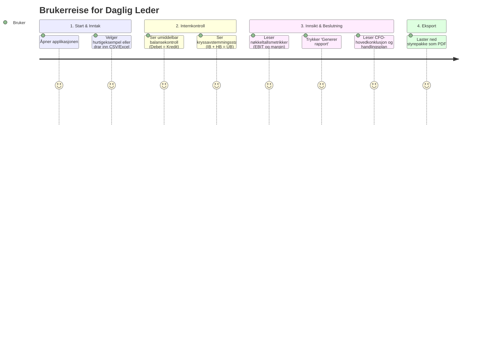

# UX-Design, Wireframes og Brukerreise (Streamlit Dashboard)

* **Dokument-ID:** UX-SPEC-01
* **Prosjekt:** G56 – Ledelsesrapport og forenklet kontroll av regnskap med KI
* **Emne:** IBE160 Programmering med KI (Kriterium 4: Design og brukeropplevelse - 10 %)
* **Formål:** Dokumentere designvalg, informasjonsarkitektur, wireframes og universell utforming for applikasjonen.

---

## 1. Målgruppe og Brukerreise

### Primærbruker: Daglig leder i SMB uten økonomisjef
* **Situasjon:** Skal i styremøte om to dager. Har mottatt en saldobalanse og hovedbok fra ekstern regnskapsfører, men forstår ikke hvorfor likviditeten er stram når resultatet er positivt, og er usikker på om regnskapet er korrekt avstemt.
* **Mål:** Laste opp filene, få bekreftet at tallene er i balanse på under 5 sekunder, og motta et velskrevet ledelsesnotat med en nedlastbar PDF-styrepakke.



---

## 2. Skjermbilde-Wireframes (ASCII / Markdown)

### Skjerm 1: Initialtilstand og Opplasting (Tomtilstand)
```text
+------------------------------------------------------------------------------------+
|  📊 Ledelsesrapport og Regnskapskontroll med KI                                    |
|  Automatisert avstemming mellom SB og HB, mapping til NS 4102 og KI-styrepakke     |
+------------------------------------------------------------------------------------+
|  [Sidebar]                 |  [Hovedfelt]                                          |
|  ⚙️ Konfigurasjon          |                                                       |
|  ( ) Last opp egne filer   |  +------------------------+  +------------------------+
|  (•) Bruk eksempel (Bal.)  |  | 1. Saldobalanse (SB)   |  | 2. Hovedbok (HB)       |
|  ( ) Bruk eksempel (Avvik) |  | [ Dra og slipp her ]   |  | [ Dra og slipp her ]   |
|                            |  +------------------------+  +------------------------+
|  🤖 KI-innstillinger       |                                                       |
|  [x] Testmodus (Mock KI)   |  ℹ️ Vennligst last opp både Saldobalanse og Hovedbok,  |
|                            |     eller velg eksempeldata i menyen til venstre.     |
+------------------------------------------------------------------------------------+
```

### Skjerm 2: Aktiv Analyse & Avstemmingsfeil (Negativ Test)
Dersom det er avvik mellom Hovedbok og Saldobalanse, fanges dette i en rød advarselboks med detaljert tabell:
```text
+------------------------------------------------------------------------------------+
|  🔍 Steg 1: Automatisk Internkontroll & Avstemming                                 |
|                                                                                    |
|  Balansekontroll: SB: ✅ Godkjent          Balansekontroll: HB: ✅ Godkjent        |
|                                                                                    |
|  ❌ Avstemmingsavvik funnet på 2 konto(er):                                        |
|  +-------+--------------------+-----------+------------+--------------+----------+ |
|  | Konto | Kontonavn          | IB        | Netto_HB   | Beregnet_UB  | UB       | |
|  +-------+--------------------+-----------+------------+--------------+----------+ |
|  | 1500  | Kundefordringer    | 50 000,00 | 10 000,00  | 60 000,00    | 90000,00 | |
|  | 1920  | Bankinnskudd       | 100 000,00| 110 000,00 | 210 000,00   | 180000,00| |
|  +-------+--------------------+-----------+------------+--------------+----------+ |
+------------------------------------------------------------------------------------+
```

### Skjerm 3: Fullverdig Dashboard (Happy Path)
```text
+------------------------------------------------------------------------------------+
|  📈 Steg 2: Nøkkeltall og Strategisk Ledelsessammendrag                             |
|                                                                                    |
|  [ Driftsinntekter ]  [ Driftskostnader ]  [ Driftsresultat (EBIT) ]  [ Margin ]   |
|     200 000 NOK           90 000 NOK              110 000 NOK           55.0 %     |
|                                                                                    |
|  [ 🚀 Generer Strategisk Ledelsesrapport (KI) ]                                    |
|                                                                                    |
|  🏆 Hovedkonklusjon til Styret:                                                    |
|  +-------------------------------------------------------------------------------+ |
|  | Selskapet leverer en solid driftsperiode med sterk lønnsomhet (EBIT 55 %).     | |
|  | Regnskapet er fullstendig avstemt mot hovedboken uten avvik.                   | |
|  +-------------------------------------------------------------------------------+ |
|                                                                                    |
|  [ 📊 Lønnsomhet & Marginer ]  [ 💧 Likviditet ]  [ 🛡️ Revisors Avstemming ]       |
|  Dyp analyse av driftsinntekter, varekostnad og skalerbarhet...                    |
|                                                                                    |
|  🚩 Identifiserte Faresignaler         🎯 Strategisk Handlingsplan                 |
|  • Kundefordringer binder kapital      [Høy] Stram inn kredittpolicy               |
|  • Lavrentekonto                       [Med] Forhandle leverandørkreditt           |
|                                        [Lav] Flytt likviditet til rentekonto       |
|                                                                                    |
|  [ 📥 Last ned Ledelsesrapport (PDF) ]                                             |
+------------------------------------------------------------------------------------+
```

---

## 3. Designprinsipper og Universell Utforming (WCAG)

* **Visuelt hierarki:** Fargene følger et semantisk mønster:
  * 🟢 **Grønn (`#16a34a`):** Matematisk godkjent balanse og fullført avstemming.
  * 🔴 **Rød (`#b91c1c`):** Kritiske balansefeil eller differanser i kryssavstemmingen.
  * 🔵 **Mørk blå (`#1e3a8a`):** Forretningsmessige overskrifter og ledelsesnotat (CFO-stil).
* **Tilgjengelighet og lesbarhet:**
  * Høy kontrast mellom tekst og bakgrunn i henhold til WCAG 2.1 AA-krav.
  * Tallformatering med tusenskilletegn (`200 000 NOK`) for umiddelbar forståelse.
  * Tydelige tomtilstander (`st.info("Vennligst last opp...")`) som veileder brukeren steg for steg uten forvirring.
* **Tastaturnavigasjon og responsivitet:**
  * Streamlits standardkomponenter støtter full tab-navigasjon via tastatur.
  * Dashboardet tilpasser seg automatisk både store skjermer og bærbare PC-er via `layout="wide"`.
