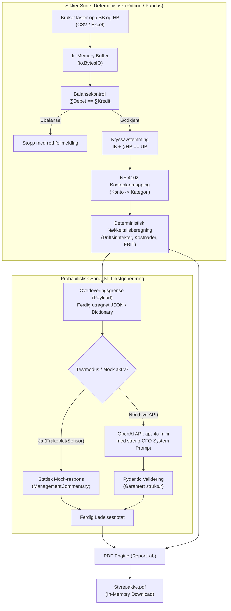
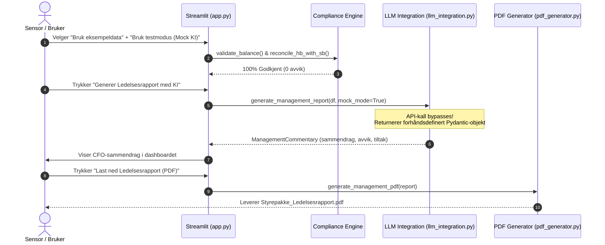

# Teknisk Arkitektur og Systemdesign (v1)
## Ledelsesrapport og forenklet kontroll av regnskap med KI

* **Dokument-ID:** ARCH-01
* **Prosjekt:** G56 – Ledelsesrapport og forenklet kontroll av regnskap med KI
* **Forankring:** Bygger direkte på `product-brief.md` og `docs/02_product/PRD.md`.
* **Formål:** Dokumentere systemarkitektur, teknologivalg, dataintegritet, og det absolutte skillet ("Firewall") mellom deterministisk tallknusing og probabilistisk tekstgenerering.

---

## 1. Teknologistakk og Begrunnelse

Teknologistakken for v1 er nøye utvalgt for å oppfylle emnets krav om enkel lokal kjørbarhet, høy regnskapsfaglig presisjon og minimal kompleksitet.

| Komponent | Teknologi | Begrunnelse for Valg |
|:---|:---|:---|
| **Frontend & Orkestrering** | **Streamlit (v1.38+)** | Gir rask prototyping av datatunge applikasjoner i ren Python. Eliminerer behovet for et separat JavaScript-frontend eller en kompleks REST API-arkitektur i v1. Støtter reaktiv tilstandshåndtering via `st.session_state`. |
| **Databehandling & Regnskapsmotor** | **Pandas (v2.2+) & NumPy** | Industristandarden for tabulær databehandling i Python. Muliggjør vektoriserte operasjoner for balansekontroll ($\sum \text{Debet} = \sum \text{Kredit}$) og kryssavstemming ($IB + \Delta HB = UB$). Bruk av `np.isclose()` eliminerer flyttallsfeil i finansberegninger. |
| **KI-integrasjon** | **OpenAI API & Pydantic (v2+)** | `gpt-4o-mini` benyttes for lynrask, kostnadseffektiv tekstformulering på norsk. Bruk av OpenAI **Structured Outputs** (`client.beta.chat.completions.parse`) sammen med Pydantic-modeller garanterer at modellen svarer i strengt definert JSON uten syntaktiske avvik. |
| **Dokumenteksport** | **ReportLab (v4.2+)** | Gir piksel-perfekt, programmatisk generering av PDF-dokumenter direkte in-memory. Unngår eksterne C-avhengigheter (som WeasyPrint ofte krever) og sikrer sømløs kjøring på tvers av Windows, macOS og Linux. |
| **Testrammeverk** | **pytest (v8.3+)** | Standard testverktøy for automatiserte enhetstester av balansekontroll, kryssavstemming og kontoplanmapping. |

---

## 2. Dataflyt og Systemgrenser ("The AI Firewall")

Den viktigste arkitektoniske garantien for sensor er at **språkmodellen aldri gjør matematiske beregninger eller avstemminger på egen hånd**. Systemet opererer med to strengt adskilte soner:



### De tre sonene i detalj

1. **Sikker Sone (Deterministisk):**
   * Rådata fra Saldobalanse (SB) og Hovedbok (HB) lastes inn i minnet.
   * Koden sjekker først at $\sum \text{Debet} = \sum \text{Kredit}$ for begge filer. Hvis det er differanse, avbrytes prosessen momentant.
   * Koden aggregerer transaksjonene i HB og verifiserer $IB + \text{netto HB} = UB$ per konto.
   * Kontoene mappes til kontoklasser etter NS 4102, og nøkkeltall (driftsinntekter, driftskostnader, driftsresultat/EBIT, driftsmargin) kalkuleres i Pandas.
   * *Absolutt ingen KI er involvert i denne sonen.*
2. **Overlevering (Payload):**
   * Kun ferdig kalkulerte totalsummer per NS 4102-kategori og eventuelle uavstemte kontoer pakkes inn i en kompakt ordbok / JSON-streng.
   * Dette sparer over 95 % av token-forbruket og hindrer sensitiv detaljlekkasje til eksterne API-er.
3. **Probabilistisk Sone (Tekstlig analyse):**
   * Payloaden oversendes til språkmodellen sammen med en rigid system-prompt som forbyr gjetting eller egne tallberegninger.
   * Modellen agerer som en rådgivende CFO og formulerer et konsist ledelsesnotat på norsk med faresignaler og tiltak.
   * Responsen parses og typesjekkes automatisk mot Pydantic-modellen `ManagementCommentary`.

---

## 3. Mappestruktur og Repo-ryddighet

For å sikre ryddighet, sporbarhet og enkel sensurering følger repositoriet denne standardiserte strukturen:

```text
G56-guimaraes/
├── data/
│   └── sample/                         # Syntetiske testdatasett med kjent fasit
│       ├── saldobalanse_balansert.csv  # Grønn test: full balanse
│       ├── hovedbok_balansert.csv      # Grønn test: matcher SB perfekt
│       ├── saldobalanse_med_ubalanse.csv # Rød test: ubalanse på 10 000 NOK
│       ├── hovedbok_med_avvik.csv      # Rød test: avvik på 30 000 NOK mot SB
│       └── README.md                   # Dokumentasjon av eksempeldata og fasit
├── docs/                               # BMAD-dokumentasjon
│   ├── 01_analysis/                    # Forretningsanalyse og domene
│   ├── 02_product/                     # PRD (Product Requirements Document)
│   │   └── PRD.md
│   ├── 03_ux/                          # UI-skisser og brukerflyt
│   ├── 04_architecture/                # Teknisk arkitektur og systemdesign
│   │   └── ARCHITECTURE.md
│   ├── BMAD_ROLES.md                   # Rolleoversikt og metodedokument
│   └── BMAD_AGENT_ENGINEERING.md       # Agent engineering og BOND-regler
├── src/                                # Kildekode
│   ├── app.py                          # Hovedapplikasjon (Streamlit)
│   ├── compliance_engine.py            # Validering (Debet=Kredit), kryssavstemming og NS 4102
│   ├── data_pipeline.py                # In-memory fillasting (CSV og Excel)
│   ├── llm_integration.py              # OpenAI Structured Outputs og frakoblet testmodus
│   └── pdf_generator.py                # In-memory ReportLab PDF-generering
├── tests/                              # Automatiserte enhetstester
│   └── test_compliance.py             # pytest-tester for regnskapslogikken
├── .env.example                        # Mal for miljøvariabler (OPENAI_API_KEY)
├── .gitignore                          # Ignorerer venv, cache, .env og midlertidige filer
├── product-brief.md                    # Det reviderte Product Briefet
├── prosjektplan.md                     # Fremdriftsplan for semesteret
├── README.md                           # Hurtigstart og instruksjoner for sensor
└── requirements.txt                    # Nødvendige Python-pakker
```

---

## 4. Frakoblet Modus (Sensormodus / Mock AI)

Et sentralt krav i emnet er at **sensor skal kunne kjøre løsningen lokalt uten egne API-nøkler eller betalte kontoer**. Dette er løst arkitektonisk gjennom en integrert mock-komponent:



### Implementasjonsdetalj for Mock-modus:
1. I grensesnittet finnes en avkrysningsboks: `Bruk testmodus (Mock KI)` (standard: **aktiv**).
2. Når denne er valgt, kaller `src/app.py` funksjonen `generate_management_report(df, mock_mode=True)`.
3. `llm_integration.py` omgår fullstendig opprettelse av `OpenAI`-klienten og nettverkskall, og returnerer umiddelbart en deterministisk, regnskapsfaglig realistisk instans av `ManagementCommentary`.
4. Dette sikrer at samtlige funksjoner – fra datavalidering via nøkkeltall til PDF-eksport – kan demonstreres og testes feilfritt på enhver PC med Python installert.

---

## 5. Sikkerhet og Databeskyttelse (In-Memory Processing)

Finansielle data og regnskapsposter er forretningskritiske. Arkitekturen ivaretar dette gjennom strenge sikkerhetsprinsipper:
* **Ingen filskriving til disk:** Både opplastede CSV/Excel-filer og genererte PDF-rapporter håndteres som strømmer i RAM (`io.BytesIO`). Filene lagres aldri i midlertidige mapper på serveren.
* **Ingen personopplysninger i repo:** Eksempeldataene i `data/sample/` er 100 % oppdiktede, syntetiske selskaper (organisasjonsnummer og reelle navn forekommer ikke).
* **Isolering av API-nøkler:** API-nøkler sendes via Streamlits passordfelt eller miljøvariabler via `.env`. `.gitignore` sørger for at `.env` aldri committedes til GitHub.
