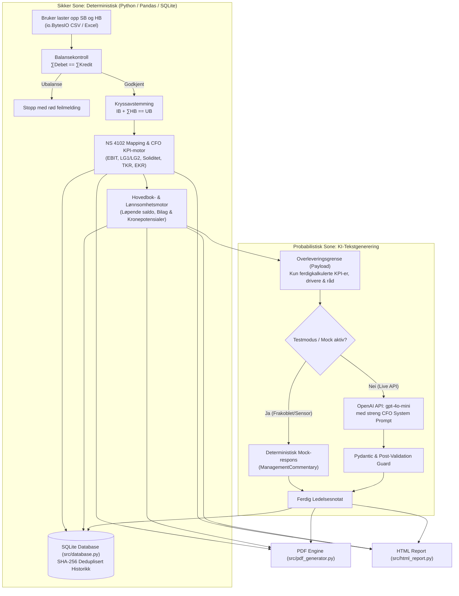

# Teknisk Arkitektur og Systemdesign (v2.0)
## Ledelsesrapport, Finansanalyse og Regnskapskontroll med KI

* **Dokument-ID:** ARCH-01
* **Versjon:** v2.0
* **Prosjekt:** G56 – Ledelsesrapport og forenklet kontroll av regnskap med KI
* **Forankring:** Bygger direkte på `product-brief.md` og `docs/02_product/PRD.md`.
* **Formål:** Dokumentere systemarkitektur, relasjonelt SQLite-datalag, flersides Streamlit-design, og det absolutte skillet ("The AI Firewall") mellom deterministisk tallknusing og probabilistisk tekstgenerering.

---

## 1. Teknologistakk og Begrunnelse

Teknologistakken er valgt for å balansere dyp finansiell analyse og historikk med emnets krav om enkel lokal kjørbarhet for sensor (Kriterium 6: null eksterne servere eller Docker).

| Komponent | Teknologi | Begrunnelse for Valg |
|:---|:---|:---|
| **Frontend & Flersides Navigasjon** | **Streamlit (`st.navigation` / `st.Page`)** | Gir en modulær, oversiktlig flersides finansapplikasjon fordelt på fire dedikerte arbeidsflater i `src/views/` uten behov for separat JS-frontend. |
| **Databehandling & CFO-motor** | **Pandas (v2.2+) & NumPy** | Vektoriserte beregninger for balansekontroll ($\sum \text{Debet} = \sum \text{Kredit}$), kryssavstemming ($IB + \Delta HB = UB$), CFO-nøkkeltall (LG1/LG2, Soliditet, TKR, EKR) og deterministiske lønnsomhetsråd. |
| **Relasjonsdatabase & Historikk** | **SQLite 3 (`sqlite3` stdlib)** | 0 eksterne avhengigheter (innebygd i Python). Støtter fremmednøkler (`ON DELETE CASCADE`), SQLite Window Functions (`SUM(...) OVER (...)`) for løpende saldo i Hovedboken, og SHA-256-deduplisert lagring av historiske analyser i en git-ignorert lokal fil (`data/g56_accounting.db`). |
| **KI-integrasjon** | **OpenAI API & Pydantic (v2+)** | `gpt-4o-mini` med **Structured Outputs** (`ManagementCommentary`) garanterer typesikker JSON-respons over *The AI Firewall*, støttet av en 100 % frakoblet Mock-modus. |
| **Dokumenteksport** | **ReportLab (v4.2+) & HTML5** | In-memory generering (`io.BytesIO`) av både utskriftsklar PDF-styrepakke og selvstendig, responsiv HTML5-rapport med XSS-escaping (`html.escape()`). |
| **Testrammeverk** | **pytest & Streamlit `AppTest`** | Automatiserte enhets- og integrasjonstester for regnskapsmotor, SQLite-database, hovedboks-drilldown, PDF/HTML-eksport og flersides UI. |

---

## 2. Dataflyt og Systemgrenser ("The AI Firewall" – v2.0)

Den viktigste arkitektoniske garantien for sensor er at **språkmodellen aldri gjør matematiske beregninger, nøkkeltallskalkulasjoner eller avstemminger på egen hånd**. Systemet opererer med strengt adskilte soner:



---

## 3. Relasjonelt Databasedesign (ER-Modell i `src/database.py`)

Databasen bruker 6 normaliserte tabeller med fremmednøkkelintegritet (`PRAGMA foreign_keys = ON`):
1. **`accounts`:** NS 4102 kontoplan (`account_no` PK, `account_name`, `ns4102_class`, `ns4102_category`).
2. **`analysis_runs`:** Metadata per regnskapsanalyse med unik `run_hash` (SHA-256 av selskap + normalisert SB + normalisert HB) som forhindrer duplikater ved Streamlit-reruns.
3. **`trial_balance_entries`:** Saldobalanselinjer per kjøring koblet til kontoplan og avstemmingsavvik.
4. **`ledger_transactions`:** Hovedboksføringer per kjøring med bilagsnummer, dato, debet, kredit og nettobeløp. Spørres med SQLite Window Function for løpende saldo per konto.
5. **`financial_metrics`:** Lagrede CFO-nøkkeltall (inkl. TKR, EKR og egenkapitalandel) samt JSON-serialiserte deterministiske lønnsomhetsråd.
6. **`ai_insights`:** Lagrede `ManagementCommentary`-rapporter knyttet til `run_id` (`ON DELETE CASCADE`).

---

## 4. Mappestruktur og Modulansvar

```text
G56-guimaraes/
├── data/
│   └── sample/                         # Syntetiske testdatasett med kjent fasit
├── docs/                               # Samlet BMAD- og prosjektdokumentasjon
│   ├── 00_course_and_brief/            # Sensorveiledning, tilbakemelding og brief-logg
│   ├── 01_analysis/                    # Domeneanalyse og avvik fra proposal
│   ├── 02_product/                     # PRD (v2.0) med Epics, Stories og sporbarhetsmatrise
│   ├── 03_ux/                          # Flersides wireframes og brukerflyt
│   └── 04_architecture/                # Teknisk arkitektur og ER-design (denne filen)
├── src/                                # Kildekode
│   ├── app.py                          # Hovedorkestrator (st.navigation, sidebar og SQLite-sync)
│   ├── app_logging.py                  # Strukturert stdout-logging
│   ├── compliance_engine.py            # Balansekontroll, avstemming, NS 4102 og CFO KPI-motor
│   ├── data_pipeline.py                # In-memory fillasting (CSV/Excel og norske tallformater)
│   ├── database.py                     # Relasjonelt SQLite-datalag med SHA-256 deduplikasjon
│   ├── ledger_analytics.py             # Hovedbok-drilldown, bilagsinspektør og lønnsomhetsmotor
│   ├── llm_integration.py              # OpenAI Structured Outputs, AI Firewall og Mock-modus
│   ├── pdf_generator.py                # In-memory ReportLab PDF-styrepakke
│   ├── html_report.py                  # In-memory selvstendig HTML5-styrepakke
│   └── views/                          # De 4 sidene i Streamlit-applikasjonen
│       ├── upload_and_control.py       # Side 1: Filopplasting, balanse- og kryssavstemming
│       ├── financial_analysis.py       # Side 2: CFO KPI-dashboard og Hovedbok-utforsker
│       ├── ai_advisor_and_export.py    # Side 3: Lønnsomhetsråd, KI-CFO og PDF/HTML-eksport
│       └── history_and_trends.py       # Side 4: SQLite-historikk og trendanalyse
├── tests/                              # Automatiserte enhets- og integrasjonstester (pytest)
│   ├── test_app_ui.py                  # Headless ende-til-ende test av flersides Streamlit UI
│   ├── test_compliance.py              # Tester for balanse, avstemming og CFO-nøkkeltall
│   ├── test_data_pipeline.py           # Tester for CSV/Excel, semikolon og kolonnenormalisering
│   ├── test_database.py                # Tester for SQLite-persistens, deduplikasjon og SQL-vindu
│   ├── test_ledger_analytics.py        # Tester for HB løpende saldo, bilag og lønnsomhetsmotor
│   └── test_reporting.py               # Tester for AI Firewall, Mock/Live KI, PDF og HTML
├── app.py                              # Hovedinngangspunkt for Streamlit (rot)
├── README.md                           # Hurtigstart og instruksjoner for sensor
└── requirements.txt                    # Nødvendige Python-pakker
```

---

## 5. Sikkerhet og Databeskyttelse

* **In-memory fil- og rapportstrømmer (`io.BytesIO`):** Opplastede råfiler (`.csv`, `.xlsx`) og eksporterte rapporter (`.pdf`, `.html`) skrives aldri som løse filer på disk.
* **Isolert lokal database:** Verifiserte analyser persisteres lokalt i `data/g56_accounting.db`, som er strengt blokkert fra versjonskontroll i `.gitignore` (`*.db`, `*.sqlite*`, `*.db-wal`, `*.db-shm`).
* **Isolering av API-nøkler:** API-nøkler håndteres i minnet via passordfelt eller lokal `.env` (ignorert av Git).
